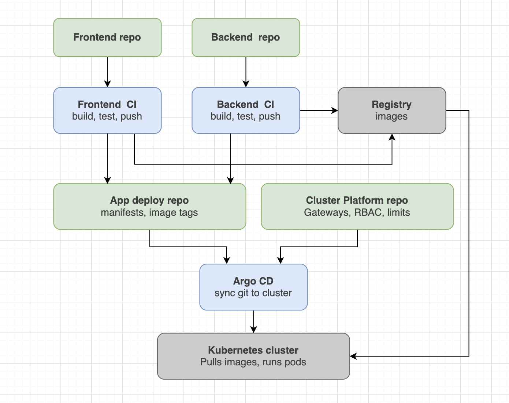

Деплой построен по модели GitOps - состояние кластера описано в репозитории, а Argo CD приводит кластер к этому состоянию. CI ничего не применяет в кластер напрямую: он только собирает образ и коммитит новый тег в репозиторий с манифестами.

В роли локального git-сервера выступает gitea из-за легкости, для удобства раннер располагается на той же ноде что и сам gitea.

В Gitea содаются 4 репы:
- frontend
- backend
- app-deploy - хранение манифестов приложения
- cluster-platform - хранение остальных манифестов с gateway, rbac и тд



Шаги релиза:

1. Разработчик пушит в main репозитория фронтенда или бэкенда.
2. Job build-and-push собирает образ и пушит его с двумя тегами:
    - `1.0.<run_number>` — версия, которая попадает в манифесты;
    - `sha-<short_sha>` — связь образа с коммитом исходников.
3. Job update-manifests (запускается только после успешного пуша) клонирует репозиторий манифестов, меняет newTag в `<app>/kustomization.yaml` и пушит коммит вида `frontend: 1.0.42`.
4. Argo CD видит новый коммит по опросу.
5. Kustomize подставляет новый тег в Deployment, Argo CD применяет его, и kubelet скачивает образ из registry.
6. Deployment выкатывает новую версию через rolling update.

### Секреты и переменные

Gitea Actions:
- `REGISTRY_HOST` — Secret (пользователь) — адрес registry, `192.168.1.205:3000`.
- `REGISTRY_USER` — Secret (пользователь) — владелец пакетов в registry.
- `REGISTRY_PASSWORD` — Secret (пользователь) — токен со scope `package: read/write` для `docker login`.
- `MANIFESTS_TOKEN` — Secret (репозитории frontend и backend) — токен со scope `write:repository` для пуша тега в репозиторий манифестов.
- `VITE_API_URL` — Variable (репозиторий frontend) — URL API, вшивается в сборку фронта через `--build-arg`.

Переменные внутри workflow:
- `IMAGE_NAME` — env workflow — имя образа: `frontend` или `backend`.
- `IMAGE_VERSION` — env workflow — версия образа: `1.0.${{ github.run_number }}`.

### Нюансы

Тег задаётся через Kustomize, а не правкой Deployment. CI меняет одну строку, Deployment остаётся неизменным:

```
images:
  - name: 192.168.1.205:3000/user1/backend
    newTag: "1.0.1"
```

Kustomize меняет тег во всех контейнерах с этим образом, включая init-контейнер migrate, поэтому миграции всегда идут из той же версии, что и приложение.

Обновление тега в CI:

```bash
sed -i "s/^\(\s*newTag:\).*/\1 \"${IMAGE_VERSION}\"/" backend/kustomization.yaml
git diff --exit-code && { echo "Тег не изменился"; exit 0; }
```

Пуш повторяется до трёх раз с `git pull --rebase`, на случай если CI фронта и бэка коммитят одновременно.

Политика синхронизации Argo CD:

```
syncPolicy:
  automated:
    prune: true      # удалять из кластера то, что удалено из git
    selfHeal: true   # откатывать ручные правки в кластере
```

С `selfHeal` ручные `kubectl edit` для ресурсов приложения откатываются. Все изменения вносятся только через git.