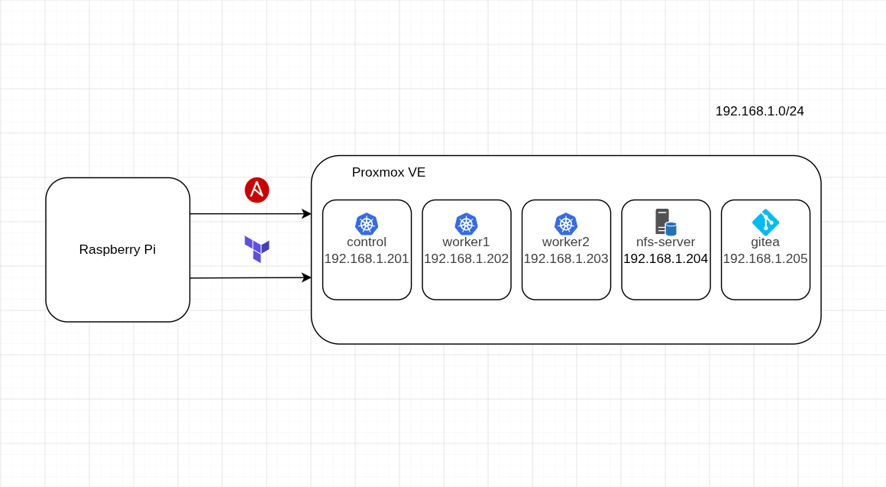

Все плейбуки и сам terraform запускается с промежуточной ноды на Raspberry Pi, на ней предварительно были установлены ansible, git и terraform



Создание виртуальных машин происходит из шаблона, который уже должен быть в Proxmox, у меня это Ubuntu-22-cloudinit. 

В качестве провайдера используется `bpg/proxmox`.

### Переменные для ВМ в terraform.tfvars

```
pm_api_url          = "https://192.168.1.77:8006/api2/json"
pm_api_token_id     = "terrauser@pve!mytoken"
pm_api_token_secret = "ur-token"

virtual_machines = {
  "control"   = { id = 201, cores = 2, memory = 3072, size = 10, ip = "192.168.1.201/24" }
  "worker1"  = { id = 202, cores = 2, memory = 3072, size = 10, ip = "192.168.1.202/24" }
  "worker2" = { id = 203, cores = 2, memory = 3072, size = 10, ip = "192.168.1.203/24" }
  "nfs-server" = { id = 204, cores = 2, memory = 1042, size = 50, ip = "192.168.1.204/24" }
  "gitea" = { id = 205, cores = 4, memory = 4092, size = 20, ip = "192.168.1.205/24" }
}
```

### Config

ansible.cfg классический на оптимизацию плейбуков и сбор логов, за исключением `host_key_checking = False`. **Так лучше не делать**, поскольку отключается проверка SSH host key, но в рамках домашнего сервера удобно.

```
[defaults]
host_key_checking = False
forks = 20 # до 20 хостов могут обрабатываться параллельно.
gathering = smart # кеширует facts, поэтому при повторных запусках не собирает их заново без необходимости.
gathering_facts = true
fact_caching = jsonfile
fact_caching_connection = /var/cache/ansible/facts
log_path = /var/log/ansible.log
roles_path = roles
interpreter_python = auto # Ansible сам ищет подходящий Python на хосте.
library = library

[connection]
pipelining = True # уменьшает количество SSH-операций, ускоряет playbook.

[ssh_connection]
ssh_args = -o ControlMaster=auto -o ControlPersist=300s -o ConnectTimeout=30 # переиспользует SSH-соединение в течение 5 минут

[privilege_escalation]
become = True
become_method = sudo
become_user = root
become_ask_pass = False
```
### Hosts.ini

Пользователь и host задается на прошлом этапе при конфигурации виртуальных машин, они должны совпадать, чтобы ansible мог к ним подключиться. 

```
[control]
control ansible_host=192.168.1.201 ansible_user=ubuntu

[workers]
worker1 ansible_host=192.168.1.202 ansible_user=ubuntu
worker2 ansible_host=192.168.1.203 ansible_user=ubuntu

[nfs]
nfs-server ansible_host=192.168.1.204 ansible_user=ubuntu

[gitea]
gitea ansible_host=192.168.1.205 ansible_user=ubuntu
```

Чтобы не переписывать инвентарь с каждым изменением terraform state, его можно автоматически подтягивать от туда
Для этого надо установить

```
ansible-galaxy collection install cloud.terraform
```

И в инвентаре создать:

```
hosts.terraform.yml
plugin: cloud.terraform.terraform_provider
project_path: ../terraform/
```

После этого плейбуки запускаем 

Также для этого надо в самом terraform прописать что именно будет записываться в state

```
resource "ansible_host" "db" {
  name   = var.vm_name
  groups = ["db_servers"]

  variables = {
    ansible_host                 = var.vm_ip
    ansible_user                 = var.vm_user
    ansible_ssh_private_key_file = "~/.ssh/id_rsa"
  }

  depends_on = [proxmox_virtual_environment_vm.nodes]
}
```

