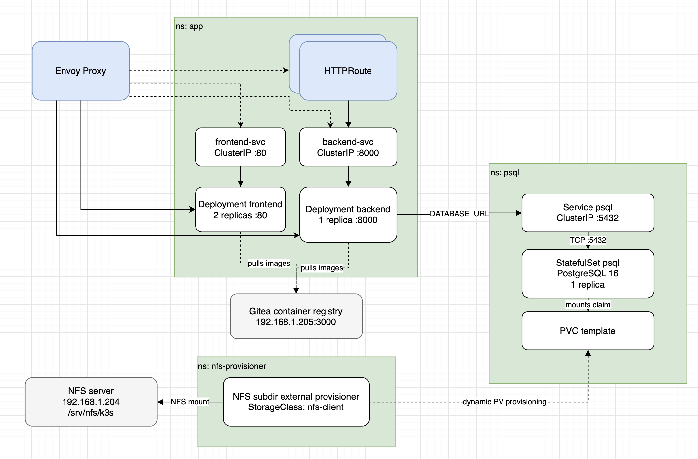

### Общая архитектура



Кластер Kubernetes развёрнут на базе k3s и предназначен для запуска полнофункционального веб-приложения, состоящего из frontend, backend и PostgreSQL.

Для внешнего доступа используется Gateway API с Envoy Gateway. MetalLB предоставляет внешний IP-адрес для LoadBalancer и обеспечивает его объявление в локальной сети.

Для хранения данных PostgreSQL используется NFS-сервер и динамическое создание PersistentVolume через NFS provisioner. Управление приложением осуществляется декларативно с помощью Kubernetes-манифестов.

### Namespaces

Компоненты распределены по namespaces, чтобы разделить приложение, базу данных и инфраструктурные сервисы:
- app - Frontend, backend, их Services, Secret и ограничения ресурсов
- psql - PostgreSQL StatefulSet, Service и Secret базы данных
- envoy - Конфигурация Gateway API и EnvoyProxy
- envoy-gateway-system - Контроллер Envoy Gateway и компоненты data plane
- metallb-system - Компоненты MetalLB для выдачи и объявления внешних IP
- nfs-provisioner - NFS provisioner для динамического создания PersistentVolume
### Приложение

Приложение представляет из себя самое простое CRUD c постами: FastAPI + PostgreSQL на бэке, React + RTK Query на фронте.

`Python`, `FastAPI`, `Alembic`, `Pydantic`, `PostgreSQL`, `React`, `TypeScript`, `Vite`, `RTK Query`, `React Router`, `Tailwind CSS`, `Docker Compose`.

##### Frontend

Frontend развёрнут через Deployment с двумя репликами. Контейнер обслуживает HTTP-запросы на порту 80.

Для внутреннего доступа создан frontend-svc типа ClusterIP, который направляет запросы на порт контейнера. Readiness и liveness пробы проверяют доступность приложения.

##### Backend

Backend развёрнут через Deployment с одной репликой. Приложение использует порт 8000 и предоставляет HTTP API. При увеличении количества реплик придется уйти от init контейнера в сторону Job, так как каждая реплика будет заново запускать миграцию бд.

Сервис backend-svc типа ClusterIP обеспечивает внутренний доступ к backend. Параметры подключения к базе данных и CORS задаются через Secret backend-env. Перед запуском приложения выполняется миграция схемы базы данных с помощью Alembic через init контейнер.

Readiness и liveness пробы используют endpoint /health.

##### Хранение данных

PostgreSQL развёрнут через StatefulSet с одной репликой и образом postgres:16-alpine. В Secret лежит пароль. Увеличение количества реплик бд потребует уже репликации (можно использовать CloudNativePG)

Для стабильного сетевого имени используется headless Service psql-headless, а обычный Service psql типа ClusterIP предоставляет доступ к базе данных на порту 5432.

Постоянное хранилище создаётся на основе volumeClaimTemplates. Для Pod PostgreSQL запрашивается PVC объёмом 5 Gi с режимом доступа ReadWriteOnce и StorageClass nfs-client.

NFS provisioner взаимодействует с NFS-сервером 192.168.1.204, используя каталог /srv/nfs/k3s. Он обеспечивает динамическое создание PersistentVolume для соответствующих PVC.

[[PVE-GiteOps-Lab/setup/Infra#NFS server|NFS server]]

### Ресурсы

В namespace app применяются два механизма управления ресурсами:

- LimitRange - задаёт допустимые минимальные и максимальные значения CPU и памяти контейнеров, а также значения по умолчанию.

```
  limits:
    - type: Container
      min:
        cpu: "50m"
        memory: "64Mi"
      max:
        cpu: "1"
        memory: "512Mi"

      defaultRequest:
        cpu: "100m"
        memory: "128Mi"
      default:
        cpu: "500m"
        memory: "256Mi"
```

- ResourceQuota - ограничивает суммарное потребление ресурсов namespace и количество отдельных типов объектов, включая Pod, Service, Secret, PVC и workload-ресурсы.

```
spec:
  hard:
    requests.cpu: "4"
    requests.memory: "8Gi"
    limits.cpu: "8"
    limits.memory: "16Gi"

    pods: "8"
    services: "4"
    configmaps: "4"
    secrets: "4"
    persistentvolumeclaims: "2"

    count/deployments.apps: "4"
    count/statefulsets.apps: "2"
    count/jobs.batch: "5"
    count/cronjobs.batch: "2"

    requests.storage: "50Gi"
```

В Deployments и StatefulSet дополнительно указаны requests и limits, определяющие запрашиваемые ресурсы и верхние пределы потребления контейнеров.

### Безопасность и RBAC

Для подключения backend к PostgreSQL используются параметры подключения из Secret. Пароль PostgreSQL также передаётся контейнеру через Secret.

RBAC определяет доступ пользователя ubuntu (по сути Developer) к ресурсам приложения и базы данных. Для этого используются ClusterRole (Можно и Role, но ClusterRole позволит применить к другим ns при желании) с наборами разрешений и namespaced RoleBinding, ограничивающие область действия этих разрешений соответствующим namespace. При этом дефолтная роль edit не подошла бы из-за того, что остается доступ к Network Policy.

Правила для app ns:

```
rules:
  - apiGroups: ["", "apps", "batch", "networking.k8s.io"]
    resources:
      - pods
      - pods/log
      - pods/exec
      - pods/portforward
      - services
      - configmaps
      - secrets
      - persistentvolumeclaims
      - deployments
      - statefulsets
      - replicasets
      - jobs
      - cronjobs
      - ingresses
      - httproutes
    verbs: [get, list, watch, create, update, patch, delete]

  - apiGroups: ["networking.k8s.io"]
    resources: [networkpolicies]
    verbs: [get, list, watch]

  - apiGroups: [""]
    resources: [limitranges, resourcequotas]
    verbs: [get, list, watch]
```

Правила для psql ограничены, чтобы нельзя было удалить бд, но при этом прокинуть порты при необходимости.

```
rules:
  - apiGroups: [""]
    resources:
      - pods
      - pods/log
      - services
      - endpoints
      - persistentvolumeclaims
      - events
    verbs: [get, list, watch]

  - apiGroups: ["apps"]
    resources: [statefulsets, replicasets]
    verbs: [get, list, watch]

  - apiGroups: [""]
    resources: [pods/portforward]
    verbs: [get, create]
```

Для NFS provisioner используется отдельный ServiceAccount с необходимыми правами на PersistentVolume, PersistentVolumeClaim, StorageClass и события Kubernetes.

