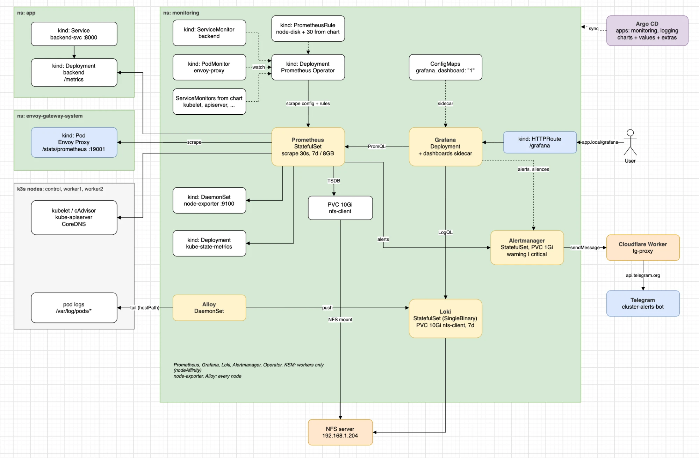
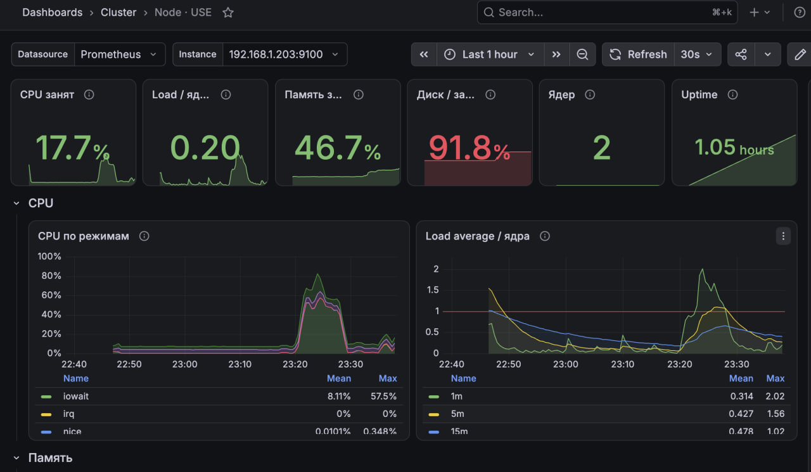
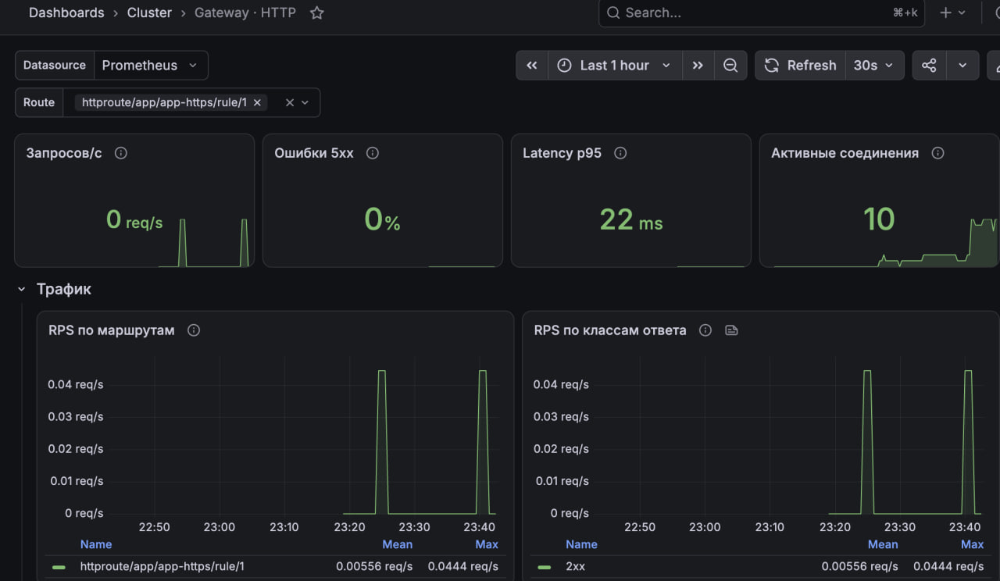
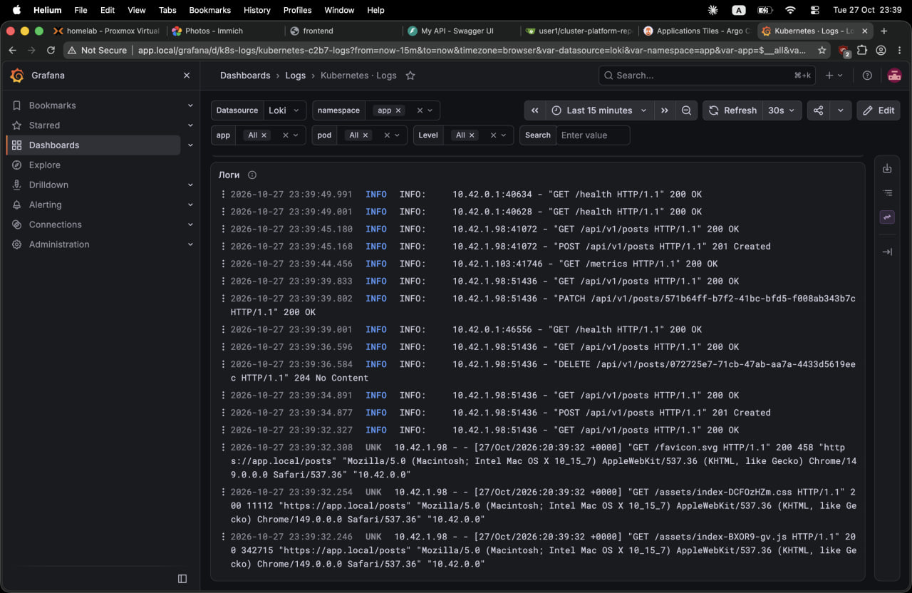
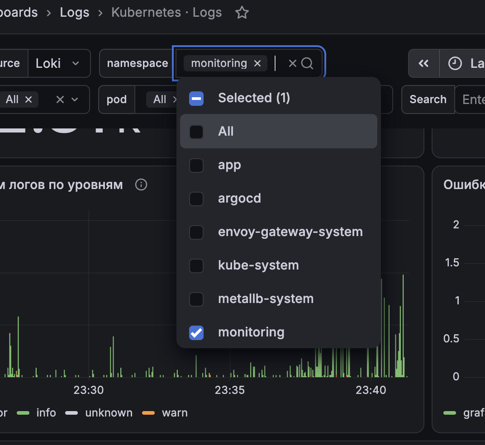
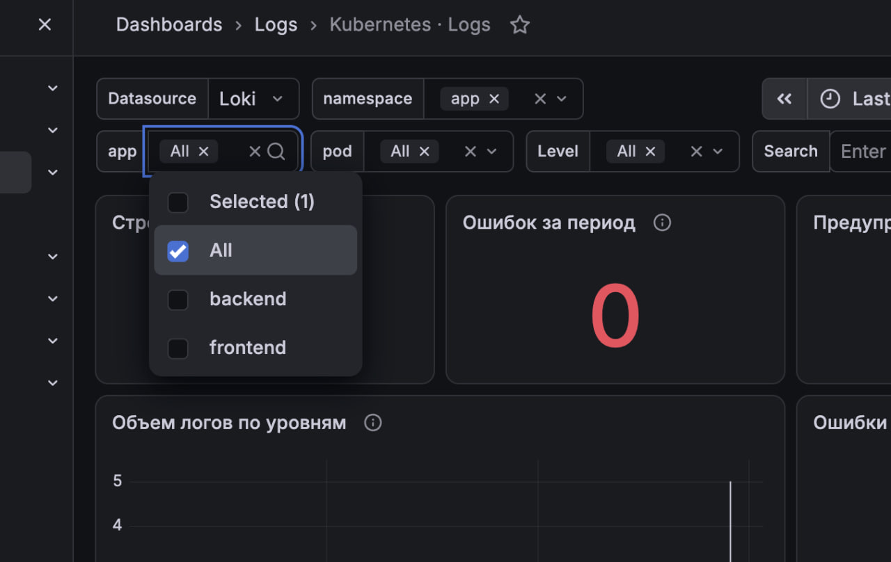
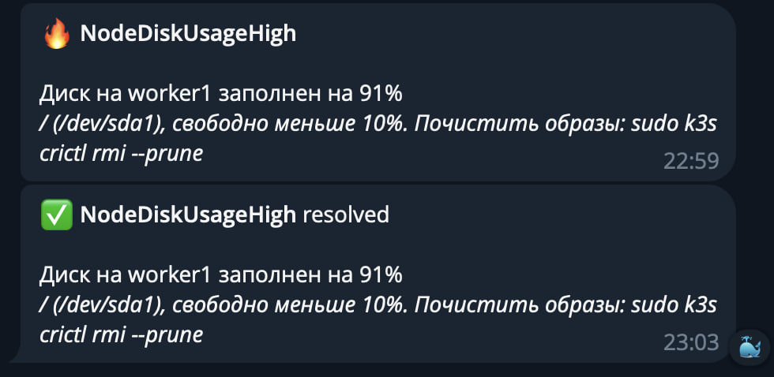

В кластере три части: метрики (Prometheus), логи (Loki + Alloy) и алерты (Alertmanager → Telegram). Смотрится всё в одной Grafana. Всё живет в отдельном namespace `monitoring` и ставится через Argo CD.

### Что стоит

Метрики, Grafana и алерты ставятся одним Helm-чартом kube-prometheus-stack: Prometheus Operator, Prometheus, Alertmanager, Grafana, node-exporter и kube-state-metrics. Отдельные чарты Prometheus и Grafana не брал: в этом стеке они уже связаны между собой, плюс есть готовые дашборды и правила алертов под Kubernetes.

Логи — отдельными чартами `loki` и `alloy` от Grafana. Promtail больше не развивается.

### Метрики

Prometheus сам по себе не знает, что скрейпить. Таргеты описываются через ServiceMonitor и PodMonitor, оператор их видит и пересобирает конфиг Prometheus. Поэтому чтобы добавить новый сервис в мониторинг, достаточно положить рядом с ним ServiceMonitor, конфиг Prometheus трогать не нужно. Prometheus подхватывает их из любого namespace, лейбл `release` не требуется. Service при этом используется только чтобы найти поды — скрейпится каждый под напрямую, по его IP.

Из чарта сразу скрейпятся node-exporter (ресурсы нод), kubelet/cAdvisor (CPU и память контейнеров), kube-state-metrics (состояние подов, деплойментов, PVC), kube-apiserver и CoreDNS.

Своих таргетов два:

- **backend** — FastAPI отдает `/metrics` через prometheus-fastapi-instrumentator, ServiceMonitor `backend` находит сервис с лейблом `app: backend` в namespace `app`. Отсюда RPS, ошибки и латентность по эндпоинтам
- **Envoy proxy** — PodMonitor `envoy-proxy` скрейпит `/stats/prometheus` у подов Envoy. Через него проходит весь входящий HTTP, так что видно трафик по каждому HTTPRoute, включая фронтенд и Argo CD, а не только бэкенд

controller-manager, scheduler, kube-proxy и etcd не скрейпятся: в k3s они живут внутри процесса `k3s` и слушают только 127.0.0.1.

Grafana сама ничего не собирает и не хранит — при каждом открытии дашборда она отправляет PromQL-запросы в Prometheus.

Дашборд ноды по методу USE (Utilization, saturation, errors) — здесь во время теста алерта на диск:

Трафик через Envoy Gateway по маршрутам HTTPRoute:

### Логи

Alloy стоит DaemonSet'ом на каждой ноде. Каждый под Alloy находит через API только поды своей ноды и читает их логи прямо с диска ноды (`/var/log/pods`, hostPath). Стримить логи через API Kubernetes не стал — это лишняя нагрузка на API-сервер на маленькой control-ноде.

По дороге Alloy разбирает формат containerd, вешает лейблы `namespace`, `pod`, `container`, `node`, `app`, выкидывает успешные пробы и скрейпы (`GET /health`, `/metrics` с кодом 200 — иначе они забивают все остальное) и вырезает из строк токен Telegram-бота. Дальше строки уходят в Loki.

Loki стоит одним подом (SingleBinary) — для лабы этого хватает, а режим по умолчанию с отдельными read/write/backend и memcached слишком тяжелый для таких нод. Уровень лога (`detected_level`) Loki определяет сам при приеме, по нему строятся графики ошибок. Включен pattern ingester, он группирует похожие строки во вкладке Patterns в Drilldown → Logs.

В Grafana Loki подключен вторым datasource, есть дашборд `Kubernetes - Logs` с фильтрами по namespace, app, pod и уровню. С дашборда бэкенда на него ведет ссылка с уже выставленным `app=backend`.

Значения фильтров берутся из лейблов в Loki, так что новые namespace и приложения появляются в списках сами. Ниже — объем логов по уровням:

### Алерты

Правила алертов — это `PrometheusRule`, их считает Prometheus. Из чарта приходит 30 `PrometheusRule` со 134 стандартными алертами для Kubernetes (ноды, поды, kubelet, PVC, API server, сам мониторинг). Свои правила лежат в `extras/alerts.yaml`, пока одно — `NodeDiskUsageHigh`: диск ноды заполнен больше чем на 90% в течение 10 минут.

Сработавший алерт Prometheus отдает в Alertmanager. Тот группирует алерты (по `alertname`, `nodename`, `namespace`), `warning` и `critical` отправляет в Telegram, а служебные `Watchdog`, `InfoInhibitor` и `info` глушит. Пока алерт горит, он повторяется раз в 4 часа, после решения приходит `resolved`.

`api.telegram.org` из сети кластера недоступен, поэтому Alertmanager отправляет сообщения через свой Cloudflare Worker, который просто проксирует запросы в Telegram. Worker пропускает только `sendMessage` и `getMe` нашего бота. Публичные «зеркала» Bot API не используются, потому что токен передается в URL. Вторая особенность сети — провайдер вешает TLS с постквантовым обменом ключами, который Go-программы предлагают по умолчанию, поэтому у Alertmanager он выключен через `GODEBUG`.

Токен бота лежит в секрете `alertmanager-telegram`, который создается руками и в git не попадает. `chat_id` секретом не является и лежит в `values.yaml`.

Так выглядит алерт на диск в Telegram — сработал и решился после удаления тестового файла:

В Grafana правила видны в Alerting → Alert rules (только чтение), горящие алерты и silence — в Alerting → Active notifications через datasource Alertmanager. Алерты в UI Grafana не создаю: у нее нет диска, и они пропадут после рестарта. Правила живут в git, как и все остальное.

### Как деплоится

Два Argo CD Application:

- `monitoring` (`app-deploy/argocd/monitoring-app.yaml`) — чарт kube-prometheus-stack с закрепленной версией, `monitoring/values.yaml` из Gitea и папка `monitoring/extras` из Gitea (namespace, HTTPRoute Grafana, ServiceMonitor/PodMonitor, свои правила и дашборды)
- `logging` (`app-deploy/argocd/logging-app.yaml`) — чарты `loki` и `alloy` и их values из `logging/` в Gitea. Ставится в тот же namespace, namespace создает `monitoring`

Чтобы обновить чарт, меняю `targetRevision` и пушу.

Из неочевидного: CRD оператора слишком большие для обычного apply, поэтому включен `ServerSideApply`. `caBundle` у вебхуков оператора после установки патчит Job, так что эти поля в `ignoreDifferences`. А в HTTPRoute дефолты (`group`, `kind`, `weight`) прописаны явно — иначе Argo CD видит их как разницу и бесконечно делает self-heal.

### Доступ

Grafana открывается на `app.local/grafana` через Envoy Gateway. Логин лежит в секрете `grafana-admin`, который создается руками и в git не попадает. Prometheus, Alertmanager, Loki и Alloy наружу не выставлены.

### Ресурсы и размещение

Ноды небольшие, по 2 CPU, 4 GB памяти и 20 GB диска. Изначально было 3 GB и 10 GB, и оба ресурса закончились: при первой установке стек сел на control-ноду рядом с k3s и Argo CD, кончилась память и API-сервер перестал отвечать. Позже с Loki и Alloy на воркерах кончился диск под образы, и kubelet начал выселять поды.

Поэтому Prometheus, Grafana, Loki, Alertmanager, оператор и kube-state-metrics через nodeAffinity живут только на воркерах. На каждой ноде, включая control, стоят только легкие DaemonSet'ы — node-exporter и Alloy. У всех контейнеров есть requests и лимиты по памяти: Prometheus до 1 GB, Grafana и Loki до 768 MB, остальное меньше. Скрейп раз в 30 секунд.

Слабое место: мониторинг живет на тех же нодах, за которыми следит. Если воркер ляжет или поды выселит DiskPressure, алерт об этом может не прийти, потому что выселен будет и сам Prometheus.

### Хранение

Данные Prometheus, Loki и Alertmanager лежат на PVC из `nfs-client`, то есть на NFS-сервере 192.168.1.204. Метрики храню 7 дней, но не больше 8 GB, логи — 7 дней. У Alertmanager на диске только silence и журнал отправок, ему хватает 1 GB. TSDB на NFS в проде так не делают, для лабы нормально.

У Grafana диска нет совсем: дашборды и datasource подтягиваются из ConfigMap при старте. Дашборды лежат json-файлами в `extras/dashboards`, sidecar Grafana находит ConfigMap с лейблом `grafana_dashboard: "1"`, а аннотация `grafana_folder` раскладывает их по папкам. Дашборд, собранный руками в UI, после рестарта пропадет, поэтому его нужно экспортировать в json и закоммитить. То же с паролем: он берется из секрета при каждом старте.