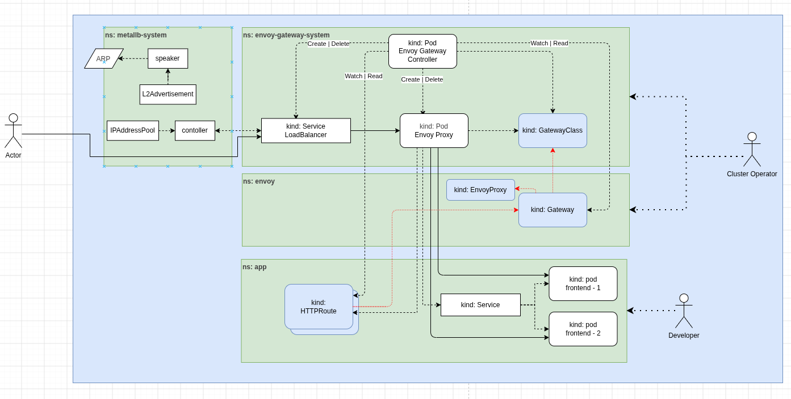

На схеме представлен путь трафика от клиента к поду приложения. 



Весь путь выглядит примерно так:
1. Клиент обращается к  External IP
2. Пакет попадает на ноду, объявляющую External IP через MetalLB
3. Service типа LoadBalancer направляет трафик на endpoint Envoy Proxy
4. Pod: Envoy Proxy принимает соединиение и применяет кофигурацию маршрутизации
5. Трафик попадает сразу на pod, в данном примере на frontend

*пунктирые стрелки* - взаимодествие объектов кластера для получения конфигураций и информации о состоянии
*толстая стрелка* - путь трафика

### MetalLB

Так как кластер локальный, то никакой облачный провайдер не может выдать внешний IP, поэтому был взят MetalLB для доступа к приложению извне. Задача MetalLB в том, чтобы предоставить некий IP адрес сервису LoadBalancer. Сам он IP адреса не берет, ему нужно предоставить пул адресов, который он будет выдавать. 
Поддерживает ARP/NDP протоколы, если необходимо BGP (для маленьких кластеров будет избыточно)

В отличие от балансировщика MetalLB будет посылать весь трафик через одну ноду (используем IP адрес, он привязывается к машине)

Перераспределение IP довольно медленное, то есть если нода упала, новый IP появится не так быстро. MetalLB ставит спикеры на все машины, но он использует стандартный ARP. 

##### Компоненты MetalLB

IPAddressPool - дает диапазон доступных IP-адресов.
MetalLB Controller - следит за Service типа LoadBalancer и назначает ему IP.
L2Advertisement - настраивает, какие IP из пулов объявлять по L2
Speaker - выбирает узел для объявления IP и отвечает на ARP
Сеть / ARP - клиент узнаёт MAC-адрес узла, через который доступен External IP

Controller и Speaker работают независимо, взаимодействуя с ресурсами Kubernetes.

##### Последовательность

1. Controller читает IPAddressPool — узнаёт диапазоны доступных IP-адресов.
2. Controller отслеживает Service типа LoadBalancer — обнаруживает сервис, которому нужен внешний IP.
3. Controller выбирает свободный IP из подходящего пула и назначает его Service. 
4. Speaker использует информацию о назначенном IP и конфигурацию L2Advertisement, чтобы объявлять этот IP в локальной сети через ARP.

### Envoy Gateway API

Для сетевого доступа приложения решено было использовать Gateway API. Он дает более четкое разграничение прав и доступа, чем Ingress, а именно Envoy был выбран в рамках эксперимента (тот же Traefik замечательно подошел бы для такого маленького проекта)

Gateway API позволяет разделить сеть на namespaces, в рамках которых будет даваться доступ к настройкам нужного объекта. Например Developer может настроить эндпоинты, фильтры, переадресацию на нужное приложение через HTTPRoute, но не сможет изменить то, как кластер принимает входящий трафик. Также можно выделить Infra Operator и Cluster Operator, но в моем случае они объединены.

В отличие от Traefik, где LoadBalancer сервис и прочее создавалось автоматически, Envoy использует отдельный контроллер, который смотрит, что мы написали в манифестах и создает поды Envoy Proxy. Т.е. Envoy Proxy - диннамическая кофигурации proxy киндов. 

##### Компоненты

- Envoy Gateway Controller - Следит за ресурсами Gateway API и управляет Envoy Proxy, обрабатывает GatewayClass, Gateway, HTTPRoute, EnvoyProxy

- Envoy Proxy - Реально принимает и проксирует трафик, фактически только через него этот трафик и проходит, причем направляет он напрямую к подам приложения предварительно получив о них информацию из Service

- kind: EnvoyProxy - Конфигурация Envoy Proxy и создаваемого Service

```
spec:
  logging:
    level: 
      default: warn
      upstream: info
  provider:
    type: Kubernetes
    kubernetes:
      envoyService:
        externalTrafficPolicy: Cluster
        type: LoadBalancer
```

В нем дополнительно прописано логирование и описание для LoadBalancer, чтобы исходящий трафик был во всем кластере, а не только на той же ноде

- GatewayClass - Определяет, какой контроллер обслуживает Gateway, и задаёт параметры реализации

- Gateway - Определяет точку входа: порты, протоколы, TLS и допустимые маршруты

```
  listeners:
    - name: http
      protocol: HTTP
      port: 80
      allowedRoutes:
        namespaces:
          from: All
    
    - name: https
      protocol: HTTPS
      port: 443
      tls:
        mode: Terminate
        certificateRefs:
          - name: local-selfsigned-tls
            namespace: envoy
      allowedRoutes:
        namespaces:
          from: All
```

В моем случае http и https для всех ns и серты которые создавали [[PVE-GiteOps-Lab/setup/Network#Создание сертификатов|Создание сертификатов]]

- HTTPRoute - Определяет маршрутизацию по hostname, пути, заголовкам и другим условиям

```
  hostnames:
    - app.local

  rules:
    - matches:
        - path:
            type: PathPrefix
            value: /api
        - path:
            type: PathPrefix
            value: /docs
        - path:
            type: Exact
            value: /openapi.json
        - path:
            type: PathPrefix
            value: /redoc
        - path:
            type: Exact
            value: /health

      backendRefs:
        - name: backend-svc
          namespace: app
          port: 8000

    - matches:
        - path:
            type: PathPrefix
            value: /

      backendRefs:
        - name: frontend-svc
          namespace: app
          port: 80
```

Также изначально backend использовал ручки без /api/v1, для этого случая использовался фильтр, который подменял /api/v1 на / и направлял трафик на backend:

```
            value: /api/v1
      filters:
        - type: URLRewrite
          urlRewrite:
            path:
              type: ReplacePrefixMatch
              replacePrefixMatch: /
```

- Service типа LoadBalancer - Предоставляет внешний IP и направляет трафик к Envoy Proxy